# Hi, I'm Hrishi Raj 👋

Software Development Engineer II at **DeepMatrix**, building geospatial pipelines and distributed backend systems. Previously at **Amazon** and **SMS DataTech (Tokyo)**. B.Tech in Computer Science, **IIT Jodhpur**.

- 🔭 Currently building photogrammetry and geospatial processing pipelines at DeepMatrix
- ⚡ Fun fact: I build and ship games solo on the Play Store, and I once worked for a Tokyo-based team

## What I work on

**🛰️ DeepMatrix**
             

**☁️ Amazon**
         

**🌐 SMS DataTech (Tokyo)**
         

**🎮 LancerLot Games**
       

## Tech stack

**Languages**
     

**Frameworks and platforms**
          

**Tools**
       

## Open source

- [Kiwix.js](https://github.com/kiwix/kiwix-js/issues/704): improved the UX of the browser extension
- [sButtons](https://github.com/sButtons/sbuttons/issues/48): style improvements

## GitHub stats

